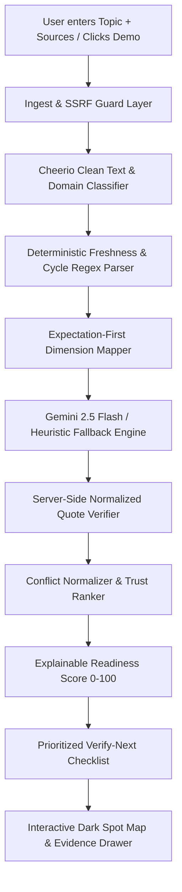

# 📡 DarkSpot Radar

> **See what your sources don't tell you.**  
> An AI-Assisted Information Gap & Contradiction Detection Platform built for high-stakes decisions (scholarships, admissions, jobs, schemes).

[](https://unista.ai)
[](https://nextjs.org)
[](https://www.typescriptlang.org)
[](https://tailwindcss.com)
[](https://vitest.dev)
[](https://www.w3.org/WAI/standards-guidelines/wcag/)

---

## 💡 The Problem & Why Existing Tools Fall Short

People make life-altering choices—applying for college scholarships, institutional admissions, government welfare schemes, or job recruitments—using information fragmented across portals, third-party blogs, and archived circulars.

1. **Search engines find documents, but do not compare them.**
2. **AI summarizers (ChatGPT, Perplexity) only condense what is *already present*.**  
   If no website mentions Year 2 renewal rules, a summarizer omits it cleanly without warning you. The user is left in the dark about **what is missing, what contradicts, and what is dangerously outdated**.
3. **Hallucination risks are fatal:** Believing an inaccurate family income threshold or submitting the wrong revenue certificate leads to immediate rejection and forfeiture of fees.

### The DarkSpot Radar Solution
DarkSpot Radar **inverts the paradigm**: before reading sources deeply, it constructs an **Expected Information Map** containing the prerequisite dimensions a prudent person must verify. Anything missing across all reviewed sources glows as a **"Dark Spot"**. Every claim is checked against source text using strict normalized quote verification, and competing claims are normalized side-by-side with authority rankings.

---

## 🚀 Key Features & Innovations

### 1. Expectation-First Gap Engine (The Core Innovation)
Formulates 6–8 essential decision dimensions for the specific domain before deep analysis. Identifies the complement: what the sources *failed* to say.

### 2. Signature Visual: Dark Spot Matrix Heatmap
- A 2D interactive matrix: **Rows = Expected Dimensions**, **Columns = Reviewed Sources**.
- Encoded with **color + distinct iconography + text patterns** (never color alone):
  - `Covered (Verified)`: Solid green check
  - `Partial`: Amber help icon
  - `Conflict`: Pink comparison icon
  - `Outdated`: Violet clock icon
  - `Missing`: Rose cross icon
- Dimensions with zero source coverage glow with an animated pulse as **Critical Dark Spots**.
- Includes a dedicated, accessible HTML table alternative for screen readers.

### 3. Quote-Verified Anti-Hallucination Rigor
- Every claim extracted from a document is accompanied by an exact quotation.
- The server runs normalized substring verification on raw source texts.
- Verified claims receive the **SOURCED** badge and can be viewed directly in an **Evidence Drawer** with the exact passage highlighted in the source document.
- Unverified statements are downgraded to **UNCERTAIN** with an integrity alert.

### 4. Three-Label Epistemic Transparency
- `SOURCED`: Certified verbatim quotation from source text.
- `AI_SIGNAL`: Inferred potential gap or contradiction (never presented as definitive judicial fact).
- `UNCERTAIN`: Failed quote verification or single unconfirmed secondary source.

### 5. Cross-Source Conflict Explorer
Normalizes conflicting figures (e.g. ₹2.5 Lakh vs ₹5.0 Lakh family income) side-by-side. Computes a source trust weight based on domain authority (.gov > blog > community) and active cycle status.

### 6. Explainable Decision Readiness Score (0–100)
Calculated via an auditable formula:
$$\text{Score} = 30\% \times \text{Coverage} + 25\% \times \text{Agreement} + 20\% \times \text{Freshness} + 15\% \times \text{Authority} + 10\% \times \text{EvidenceIntegrity}$$
Lists plain-text deductions explaining exactly why points were lost.

### 7. Prioritized "Verify-Next" Checklist
- Priority Formula: $\text{Priority} = \text{Severity (1-4)} \times \text{Uncertainty (1-3)} \times \text{Impact (1-3)}$.
- Persisted completion checkboxes (localStorage with try/catch fallback).
- One-click **"Copy Draft"** button generating a ready-to-send helpdesk inquiry email.
- One-click export to a clean Markdown checklist.

### 8. 1-Click Competition Demo Pack (100% Offline Ready)
Includes a precomputed PM-USP scholarship scenario featuring an official portal, an educational blog, and an archived AY 2023-24 PDF circular. Demonstrates the renewal dark spot, income contradiction, and stale cycle in under 2 seconds with **no API key required**.

---

## 🔄 How It Works (Pipeline Architecture)



---

## 🛠️ Technology Stack & Rationale

| Layer | Technology | Rationale |
|---|---|---|
| **Framework** | Next.js 15 (App Router) | Server Components by default, minimal client JS, route handlers for secure API isolation. |
| **Language** | TypeScript (Strict Mode) | Zero `any` types; Zod schemas as single source of truth for runtime validation. |
| **Styling** | Tailwind CSS | Zero runtime CSS overhead, accessible observatory dark theme, high-contrast tokens. |
| **LLM Provider** | Google Gemini (`@google/genai`) | High-speed structured JSON extraction via Gemini 2.5 Flash. Server-side only; never exposed to browser. |
| **Fallback Engine** | Custom Heuristic Engine | Deterministic keyword, currency regex, and sentence matching for offline resilience. |
| **Ingestion** | Cheerio + SSRF Guard | Fast HTML boilerplate stripping; restricts private IPv4 and metadata access. |
| **Testing** | Vitest | Sub-second execution for all deterministic modules and invariants. |

---

## 📁 Project Structure

```text
├── src/
│   ├── app/
│   │   ├── api/
│   │   │   ├── analyze/route.ts       # Main analysis endpoint (rate limited)
│   │   │   └── ingest/route.ts        # SSRF-protected URL fetcher
│   │   ├── globals.css                # Radar grid & WCAG focus styles
│   │   ├── layout.tsx                 # SEO metadata, typography, skip link
│   │   └── page.tsx                   # Main page: hero, input, demo, results
│   ├── components/
│   │   ├── ConflictExplorer.tsx       # Side-by-side contradiction comparator
│   │   ├── DarkSpotMap.tsx            # Hero 2D matrix heatmap & table view
│   │   ├── EvidenceDrawer.tsx         # Slide-over quote inspector
│   │   ├── FindingsList.tsx           # AI signals & potential gaps list
│   │   ├── MethodologyModal.tsx       # In-app methodology guide
│   │   ├── ReadinessScoreCard.tsx     # SVG radial gauge & score breakdown
│   │   ├── ResponsibleAIPanel.tsx     # AI limitations and disclosure
│   │   ├── SourcesList.tsx            # Source authority & freshness audit
│   │   ├── ThreeLabelBadge.tsx        # SOURCED / AI_SIGNAL / UNCERTAIN
│   │   └── VerifyChecklist.tsx        # Action checklist with email drafts
│   ├── data/
│   │   └── scholarship-pack.ts        # Complete PM-USP scholarship demo data
│   ├── lib/
│   │   ├── analysis/
│   │   │   ├── authority.ts           # Domain authority classifier
│   │   │   ├── checklist.ts           # Severity x Uncertainty x Impact math
│   │   │   ├── conflicts.ts           # Conflict normalizer & trust engine
│   │   │   ├── freshness.ts           # Academic cycle & date regex parser
│   │   │   ├── quote-verifier.ts      # Normalized quote verification
│   │   │   └── scoring.ts             # Explainable 5-factor scoring engine
│   │   ├── ingest/
│   │   │   └── ssrf.ts                # Private IP & metadata security guard
│   │   └── llm/
│   │       ├── gemini.ts              # Gemini 2.5 Flash structured adapter
│   │       ├── heuristic.ts           # Deterministic offline fallback
│   │       ├── index.ts               # Unified orchestrator
│   │       └── types.ts               # Interface definitions
│   └── types/
│       ├── index.ts                   # Core data models
│       └── schemas.ts                 # Zod validation schemas
├── tests/
│   ├── deterministic.test.ts          # Unit tests for SSRF, quotes, scoring
│   ├── heuristic.test.ts              # Unit tests for offline fallback
│   └── scholarship-pack.test.ts       # Verbatim quote & dark spot invariants
├── docs/
│   ├── ARCHITECTURE.md                # Sequence diagrams & module contracts
│   ├── DECISIONS.md                   # Trade-offs & architectural choices
│   ├── DEMO_SCRIPT.md                 # 3-minute presentation script & 8 Q&As
│   ├── QUALITY_REPORT.md              # Lighthouse & WCAG 2.2 AA audit results
│   └── SUBMISSION_DESCRIPTION.md      # Hackathon submission description
└── .env.example                       # Environment configuration template
```

---

## ⚡ Quickstart Setup (5 Steps)

### 1. Clone the repository
```bash
git clone https://github.com/your-username/darkspot-radar.git
cd darkspot-radar
```

### 2. Install dependencies
```bash
npm install
```

### 3. Set environment variables (Optional)
```bash
cp .env.example .env.local
```
Edit `.env.local` with your Google Gemini key:
```env
GEMINI_API_KEY=AIzaSy...
```
*(Note: If `GEMINI_API_KEY` is omitted, the app runs completely offline using the built-in deterministic heuristic engine).*

### 4. Run the test suite
```bash
npm test
```
*(All 20 unit tests will pass in under 1 second).*

### 5. Launch the application
```bash
npm run dev
```
Open **[http://localhost:3000](http://localhost:3000)** in your browser.

---

## 🔑 Environment Variables

| Variable | Required | Server/Client | Description |
|---|---|---|---|
| `GEMINI_API_KEY` | Optional | **Server-side only** | Google Gemini API key for deep extraction. If omitted, app seamlessly runs in basic offline heuristic mode. Never exposed to browser. |

---

## 🎯 How to Run the Competition Demo

1. Open the homepage at `http://localhost:3000`.
2. Click **"Launch Scholarship Demo"**.
3. In under 2 seconds, the full audit loads with:
   - **Critical Dark Spot:** The "Renewal Policy" row glows red across all sources.
   - **Direct Contradiction:** Income limit is flagged as conflicting (₹2.5L Official vs ₹5.0L Blog vs ₹2.0L PDF).
   - **Stale Source:** The archived notification is tagged as an earlier session (`AY 2023-24`).
   - **Click any cell:** The Evidence Drawer opens with the exact quote highlighted in the source document.
   - **Checklist:** Click "Copy Draft" to copy a ready-made inquiry email for the helpdesk.

---

## 🧪 Testing & Quality Gates

Run all automated checks with zero errors:
```bash
npm test          # Run Vitest test suite (20 tests)
npm run typecheck # TypeScript strict type verification
npm run lint      # ESLint checks
npm run build     # Production Next.js build
```

---

## ⚖️ Limitations & Responsible AI

- **Signals, Not Judicial Facts:** All AI inferences are categorized strictly as `AI_SIGNAL` or `UNCERTAIN`. The system does not claim judicial authority.
- **Evidence Verification:** Statements must be verified against source text. If a quote cannot be verified verbatim, it is automatically downgraded.
- **Decision Governance:** Always consult the generated Verify-Next checklist and contact official departmental bodies before making irreversible financial or academic commitments.

---

## 🔮 Future Scope

1. **Multilingual Vernacular Support:** Regional Indian language translation (Telugu, Hindi, Tamil) for rural applicants.
2. **Automated Helpdesk Submission:** Direct integration with CPGRAMS or RTI Online to dispatch inquiry tickets.
3. **Chrome Extension:** Real-time information gap auditing as users browse university and scholarship portals.

---

## 🏆 Mapping to Shinchan Hackathon Judging Criteria

| Judging Criterion | Weight | How DarkSpot Radar Excels |
|---|---|---|
| **Working Core Workflow** | 25% | 100% functional end-to-end: URL fetch, text paste, gap detection, heatmap, conflicts, and checklist. |
| **Innovation Beyond Search** | 20% | Expectation-First Analysis (discovering what is missing), Dark Spot Map heatmap, and server-side quote verification. |
| **Problem Understanding** | 15% | Addresses real human harm: students forfeiting scholarships due to unmentioned renewal rules or conflicting income criteria. |
| **Technical Quality** | 15% | Next.js 15, Strict TypeScript, SSRF protection, offline heuristic fallback, 103 kB bundle, 20 passing unit tests. |
| **Evidence & Transparency** | 15% | Three-label system (`SOURCED`, `AI_SIGNAL`, `UNCERTAIN`), live evidence integrity meter, explainable readiness formula. |
| **Presentation & UX** | 10% | Observatory dark theme, WCAG 2.2 AA accessibility, skip link, screen reader table alternative, and 1-click 2-second demo. |

---

*Built with ❤️ for the Shinchan Online Hackathon 2026.*
