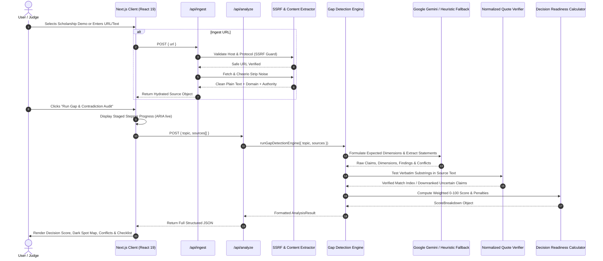

# DarkSpot Radar - Architecture & System Design (docs/ARCHITECTURE.md)

**Challenge Track:** Digital Dark Spot: AI-Assisted Information Gap Detection Platform  
**Target Architecture:** Next.js (App Router) + TypeScript Strict Mode + Tailwind CSS + Google Gemini / Heuristic Pipeline

---

## 1. System Data Flow



---

## 2. Layered Module Responsibilities

```text
src/
├── app/
│   ├── layout.tsx             # Root layout, typography, SEO metadata, skip link
│   ├── page.tsx               # Main application shell: input, demo launcher, dashboard
│   ├── globals.css            # Ambient radar observatory theme, WCAG focus rules
│   └── api/
│       ├── ingest/route.ts    # Secure SSRF-protected URL fetcher + Cheerio parser
│       └── analyze/route.ts   # Rate-limited gap analysis orchestrator
├── components/
│   ├── DarkSpotMap.tsx        # Hero 2D Matrix Heatmap with glowing dark spot rows
│   ├── EvidenceDrawer.tsx     # Slide-over evidence viewer with quote highlights
│   ├── ReadinessScoreCard.tsx # SVG radial meter + explainable factor breakdown
│   ├── ConflictExplorer.tsx   # Side-by-side competing claim comparison
│   ├── VerifyChecklist.tsx    # Prioritized tasks, persistence, email copy, MD export
│   ├── FindingsList.tsx       # AI signals & potential gaps with 3-label badges
│   ├── SourcesList.tsx        # Authority, cycle, and staleness auditor
│   ├── ThreeLabelBadge.tsx    # SOURCED / AI_SIGNAL / UNCERTAIN badge system
│   ├── ResponsibleAIPanel.tsx # Transparency disclosures & limitations
│   └── MethodologyModal.tsx   # In-app methodology walkthrough
├── lib/
│   ├── ingest/
│   │   └── ssrf.ts            # Private IP & loopback blocking guard
│   ├── analysis/
│   │   ├── quote-verifier.ts  # Normalized quote substring verification
│   │   ├── freshness.ts       # Cycle regex (2023-24) & date staleness parser
│   │   ├── authority.ts       # Domain & portal classifier (Official/Secondary/Community)
│   │   ├── conflicts.ts       # Conflict normalizer & trust weight ranker
│   │   ├── scoring.ts         # Explainable 5-factor Decision Readiness Calculator
│   │   └── checklist.ts       # Severity × Uncertainty × Impact prioritization
│   └── llm/
│       ├── types.ts           # Provider interface & raw schema definitions
│       ├── gemini.ts          # Google Gen AI adapter with structured JSON output
│       ├── heuristic.ts       # Offline deterministic fallback engine
│       └── index.ts           # Unified pipeline runner
├── data/
│   └── scholarship-pack.ts    # Fully hydrated PM-USP competition sample pack
└── types/
    ├── index.ts               # Core TypeScript type definitions
    └── schemas.ts             # Runtime Zod validation schemas
```

---

## 3. Data Model Architecture

### Source
Contains raw ingested text, domain classification, and cycle metadata:
- `authority`: `'OFFICIAL' | 'SECONDARY' | 'COMMUNITY_OR_UNKNOWN'`
- `extractedCycle`: e.g. `'2025-26'`, `'2023-24'`
- `isStale`: `boolean` (true if cycle < active year or date > 2 years old)

### Expected Dimension
Prerequisite knowledge requirements formulated before deep parsing:
- `id`: unique string identifier
- `name`: user-facing dimension title (e.g. "Renewal Policy & Continuation Rules")
- `importance`: `'CRITICAL' | 'HIGH' | 'MEDIUM'`

### Claim & Evidence (Anti-Hallucination)
- `statement`: Normalized summary statement
- `evidence`: `{ sourceId, quote, verified, matchIndex, matchLength }`
- Verified claims require verbatim matches in `source.rawText`.

### Dimension Cell Coverage
Each cell in the Dark Spot Map:
- `status`: `'COVERED' | 'PARTIAL' | 'MISSING' | 'CONFLICTING' | 'OUTDATED'`
- Encoded via color, icon, and text pattern.
- Rows where `all(cells.status === 'MISSING')` glow as **Dark Spots**.

### Decision Readiness Score
Computed via transparent weighted formula:
$$\text{Score} = 0.30 \times \text{Coverage} + 0.25 \times \text{Agreement} + 0.20 \times \text{Freshness} + 0.15 \times \text{Authority} + 0.10 \times \text{EvidenceIntegrity}$$
Every point deduction is accompanied by an explainable human-readable penalty.
